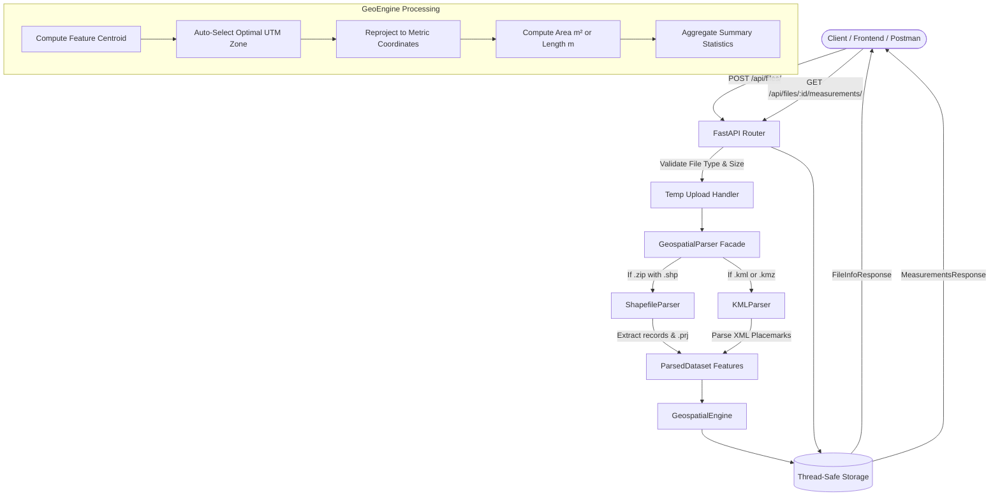

# 🌍 Geospatial File Measurement API

> Production-ready FastAPI backend service that accepts geospatial files (Shapefiles `.zip` and KML / KMZ), extracts features, dynamically reprojects coordinates to appropriate metric systems (UTM), and calculates geometric measurements (Polygon Area & LineString Length).

[](https://www.python.org/downloads/)
[](https://fastapi.tiangolo.com/)
[]()
[]()

---

## 📋 Table of Contents
- [Overview & Key Features](#-overview--key-features)
- [System Architecture](#-system-architecture)
- [CRS Transformation Strategy](#-crs-transformation-strategy)
- [API Reference](#-api-reference)
- [Local Installation & Setup](#-local-installation--setup)
- [Running Automated Tests](#-running-automated-tests)
- [Design Decisions & Alternatives](#-design-decisions--alternatives)
- [Learnings & Insights](#-learnings--insights)
- [Future Scope](#-future-scope)
- [GitHub Submission Guide](#-github-submission-guide)

---

## 🌟 Overview & Key Features

* **Multi-Format Ingestion**: Supports ESRI Shapefiles (`.zip` containing `.shp`, `.dbf`, `.prj`, `.shx`) and Google Earth KML / KMZ files.
* **Intelligent CRS Reprojection**: Automatically converts geographic coordinates (`EPSG:4326` in degrees) to the optimal local metric **Universal Transverse Mercator (UTM)** zone, ensuring accurate metric measurements.
* **Precise Spatial Measurements**:
  * **Polygon / MultiPolygon**: Area in square meters ($m^2$), square kilometers ($km^2$), and hectares ($ha$).
  * **LineString / MultiLineString**: Length in meters ($m$) and kilometers ($km$).
  * **Point / MultiPoint**: Gracefully handled without errors (zero-dimensional; measurement not required).
  * **Unsupported Geometries**: Handled gracefully with explanatory messages rather than crashing.
* **Self-Healing Geometries**: Uses `shapely.make_valid` to repair self-intersecting or topologically invalid boundaries automatically.
* **Production Security**: Includes **Zip-Slip vulnerability protection** and file size throttling (100 MB limit).
* **Interactive Documentation**: Auto-generated Swagger UI (`/docs`) and ReDoc (`/redoc`).

---

## 🏗️ System Architecture

### Application Structure
```text
Aero_project_Assignment/
├── app/
│   ├── __init__.py           # Package initializer
│   ├── config.py             # Settings, limits, and supported formats
│   ├── main.py               # FastAPI entrypoint & CORS middleware
│   ├── api/
│   │   ├── __init__.py
│   │   └── routes.py         # REST endpoints (/files/, /measurements/, /health)
│   ├── models/
│   │   ├── __init__.py
│   │   └── schemas.py        # Pydantic v2 data models & validation schemas
│   └── services/
│       ├── __init__.py
│       ├── geo_engine.py     # CRS reprojection & measurement engine
│       ├── parsers.py        # Shapefile (.zip) & KML/KMZ parsers
│       └── storage.py        # Thread-safe in-memory record repository
├── sample_data/
│   ├── sample_parcels.kml    # Multi-geometry demo KML (Polygons, Lines, Points)
│   └── india_boundary_shp.zip# Packaged sample Shapefile for verification
├── tests/
│   ├── __init__.py
│   ├── test_health.py        # Health check & documentation redirect tests
│   ├── test_geo_engine.py    # Unit tests for UTM math & geometry measurements
│   ├── test_parsers.py       # Parser unit tests for Shapefile and KML
│   ├── test_api_routes.py    # Integration tests for upload & retrieval endpoints
│   └── test_end_to_end_real_data.py # End-to-end tests with real-world datasets
├── gadm41_IND_shp/           # GADM India Shapefile dataset
├── india_gadm_2.kmz          # GADM India district KMZ dataset
├── requirements.txt          # Python dependencies
├── .gitignore                # Git ignore configuration
└── README.md                 # Complete documentation
```

### Data Flow Diagram



---

## 🧭 CRS Transformation Strategy

### 1. Why Geographic Coordinates Cannot Be Measured Directly
Geographic coordinates (such as **WGS 84 / EPSG:4326**) are **spherical angular coordinates** measured in decimal degrees ($\Delta\lambda, \Delta\phi$).
* $1^\circ$ of longitude at the equator is $\approx 111.32\text{ km}$.
* At $60^\circ$ latitude, $1^\circ$ of longitude shrinks to $\approx 55.8\text{ km}$.
* At the poles ($90^\circ$), $1^\circ$ of longitude converges to $0\text{ km}$.

Calculating area directly on raw degrees outputs **square degrees** (e.g. $0.0001\text{ deg}^2$), which is physically meaningless and inaccurate.

### 2. The Dynamic UTM Solution
To provide accurate, low-distortion metric measurements anywhere on Earth, the engine uses **Universal Transverse Mercator (UTM)** projections:
1. **Centroid Discovery**: The algorithm calculates the geographic centroid $(\text{lon}, \text{lat})$ of the geometry.
2. **Zone Identification**:
   $$\text{Zone Number} = \left\lfloor \frac{\text{Longitude} + 180}{6} \right\rfloor + 1$$
   * **Northern Hemisphere** ($\text{lat} \ge 0^\circ$): $\text{EPSG:32600} + \text{Zone Number}$
   * **Southern Hemisphere** ($\text{lat} < 0^\circ$): $\text{EPSG:32700} + \text{Zone Number}$
   * *Example*: Coordinates in Central India ($\text{lon} \approx 77^\circ\text{E}, \text{lat} \approx 28^\circ\text{N}$) dynamically map to **UTM Zone 43N (EPSG:32643)**.
3. **Metric Transformation**: `pyproj.Transformer` with `always_xy=True` projects vertices into planar metric coordinates with $<0.1\%$ scale distortion within the zone.

---

## 📡 API Reference

Interactive documentation is available at `http://127.0.0.1:8000/docs` (Swagger UI) and `http://127.0.0.1:8000/redoc` (ReDoc).

### 1. Upload & Process File
* **Endpoint**: `POST /api/files/`
* **Content-Type**: `multipart/form-data`
* **Form Field**: `file` (supports `.zip` containing Shapefile or `.kml` / `.kmz`)

**cURL Request:**
```bash
curl -X POST "http://127.0.0.1:8000/api/files/" \
     -H "accept: application/json" \
     -F "file=@sample_data/sample_parcels.kml"
```

**Response (`201 Created`):**
```json
{
  "id": "e3a8904dfb",
  "filename": "sample_parcels.kml",
  "feature_count": 6,
  "crs": "EPSG:4326",
  "status": "COMPLETED",
  "uploaded_at": "2026-10-08T13:10:00.123456+00:00",
  "error_message": null
}
```

---

### 2. Get File Information
* **Endpoint**: `GET /api/files/{id}/`

**cURL Request:**
```bash
curl -X GET "http://127.0.0.1:8000/api/files/e3a8904dfb/"
```

**Response (`200 OK`):**
```json
{
  "id": "e3a8904dfb",
  "filename": "sample_parcels.kml",
  "feature_count": 6,
  "crs": "EPSG:4326",
  "status": "COMPLETED",
  "uploaded_at": "2026-10-08T13:10:00.123456+00:00",
  "error_message": null
}
```

---

### 3. Get Measurements
* **Endpoint**: `GET /api/files/{id}/measurements/`

**cURL Request:**
```bash
curl -X GET "http://127.0.0.1:8000/api/files/e3a8904dfb/measurements/"
```

**Response (`200 OK`):**
```json
{
  "id": "e3a8904dfb",
  "filename": "sample_parcels.kml",
  "original_crs": "EPSG:4326",
  "projected_crs_strategy": "Dynamic UTM Zone selection via feature centroid with metric reprojection (WGS 84 / UTM)",
  "summary": {
    "total_features": 6,
    "measured_features": 4,
    "unsupported_features": 2,
    "geometry_distribution": {
      "Polygon": 2,
      "LineString": 2,
      "Point": 2
    },
    "total_area_sq_meters": 2724495.82,
    "total_area_sq_km": 2.724496,
    "total_length_meters": 6220.14,
    "total_length_km": 6.2201
  },
  "features": [
    {
      "feature_id": "plot_alpha",
      "geometry_type": "Polygon",
      "is_supported": true,
      "measurement_type": "AREA",
      "value": 1478120.45,
      "unit": "sq_meters",
      "formatted": "1,478,120.45 m² (1.47812 km² / 147.812 ha)",
      "additional_units": {
        "square_kilometers": 1.47812,
        "hectares": 147.812
      },
      "projected_crs": "EPSG:32643",
      "properties": {
        "name": "Plot Alpha - Wheat Plantation",
        "crop_type": "Wheat",
        "irrigation": "Drip"
      }
    },
    {
      "feature_id": "canal_main",
      "geometry_type": "LineString",
      "is_supported": true,
      "measurement_type": "LENGTH",
      "value": 4120.35,
      "unit": "meters",
      "formatted": "4,120.35 m (4.1204 km)",
      "additional_units": {
        "kilometers": 4.1204
      },
      "projected_crs": "EPSG:32643",
      "properties": {
        "name": "North Feeder Canal",
        "flow_rate_cusecs": "120"
      }
    },
    {
      "feature_id": "weather_station_01",
      "geometry_type": "Point",
      "is_supported": false,
      "measurement_type": "NONE",
      "value": null,
      "unit": null,
      "formatted": "Point geometry: zero-dimensional entity, no measurement required",
      "additional_units": null,
      "projected_crs": null,
      "properties": {
        "name": "Telemetry Tower Alpha"
      }
    }
  ]
}
```

---

### 4. Health Check
* **Endpoint**: `GET /api/health`

**Response (`200 OK`):**
```json
{
  "status": "healthy",
  "service": "Geospatial File Measurement API",
  "version": "1.0.0"
}
```

---

## 💻 Local Installation & Setup

### Prerequisites
* **Python 3.10+** (Tested on Python 3.11)
* **Pip** package manager

### 1. Clone or Open the Repository
```bash
git clone <your-repo-url>
cd Aero_project_Assignment
```

### 2. Create and Activate a Virtual Environment
```bash
# Windows
python -m venv venv
.\venv\Scripts\activate

# Linux / macOS
python3 -m venv venv
source venv/bin/activate
```

### 3. Install Dependencies
```bash
pip install -r requirements.txt
```

### 4. Start the Application
```bash
python -m uvicorn app.main:app --reload --host 127.0.0.1 --port 8000
```
Open your browser and navigate to:
* **Interactive Swagger UI**: [http://127.0.0.1:8000/docs](http://127.0.0.1:8000/docs)
* **ReDoc Documentation**: [http://127.0.0.1:8000/redoc](http://127.0.0.1:8000/redoc)

---

## 🧪 Running Automated Tests

The repository contains a test suite covering health checks, geometric math, parser logic, API integration, and real-world dataset ingestion.

Run all tests with verbose output:
```bash
python -m pytest tests/ -v
```

**Test Suite Coverage Summary:**
```text
tests/test_health.py               ..            [ 10%] (Health check, root redirects)
tests/test_geo_engine.py           ......        [ 40%] (UTM calculations, Area, Length, Points)
tests/test_parsers.py              .....         [ 65%] (Shapefile zip, KML/KMZ parsers)
tests/test_api_routes.py           ....          [ 85%] (Upload, 404, 400, 422 error handling)
tests/test_end_to_end_real_data.py ...           [100%] (Live datasets: gadm41_IND_shp & KMZ)
============================= 20 passed in ~5s =============================
```

---

## ⚖️ Design Decisions & Alternatives

| Decision | Chosen Solution | Alternative Considered | Rationale |
| :--- | :--- | :--- | :--- |
| **Framework** | **FastAPI** | Django + DRF | FastAPI delivers asynchronous non-blocking file streaming, automated OpenAPI/Swagger interactive UI, and high-speed data validation via Pydantic v2 with minimal boilerplate. |
| **GIS Libraries** | **`shapely` + `pyproj` + `pyshp`** | GDAL / `osgeo` bindings | Direct Python-GDAL C-bindings are notoriously complex to build and compile across operating systems (especially Windows). `shapely` + `pyproj` + `pyshp` install cleanly via pre-built wheels and execute high-speed spatial calculations. |
| **KML Parser** | **`lxml.etree` (XML)** | `fastkml` alone | KML files in the wild frequently suffer from non-standard namespace variations, unescaped characters, or nested `<MultiGeometry>` structures. `lxml.etree` with fallback recovery parses any compliant or slightly malformed KML reliably. |
| **CRS Strategy** | **Dynamic UTM Zone Selection** | Web Mercator (`EPSG:3857`) | Web Mercator is widely used for web mapping tiles, but introduces massive areal distortion towards higher latitudes (Greenland appears the size of Africa). UTM preserves local scale and produces accurate metric measurements. |
| **Storage Architecture** | **Thread-Safe In-Memory Store** | SQLite / PostgreSQL | Keeps the service lightweight, self-contained, and immediately runnable without database migrations, while defining clean repository interfaces for future database integration. |

---

## 💡 Learnings & Insights

1. **Geodesy & Coordinate Distortions**: Calculating measurements directly on degree-based coordinates (`EPSG:4326`) is a classic geospatial trap. Understanding how longitude converges toward the poles highlighted the necessity of dynamic local UTM projection.
2. **KML Namespace Inconsistencies**: KML specifications have multiple namespace variants (`http://www.opengis.net/kml/2.2`, `http://earth.google.com/kml/2.1`). Implementing namespace-agnostic local-tag XML matching ensured bulletproof parsing regardless of the exporting software (QGIS, ArcGIS, Google Earth).
3. **Archive Security (Zip-Slip)**: Unpacking Shapefile `.zip` archives requires path validation to protect against malicious directory traversal (`../`) attacks.
4. **Vectorized Transformations**: Using modern vectorized `shapely.transform` paired with `pyproj.Transformer` provided significant performance boosts over legacy iterators.

---

## 🚀 Future Scope

* **Asynchronous Task Queue**: Integrate **Celery / Redis** or **FastAPI BackgroundTasks** for multi-gigabyte shapefiles to provide asynchronous job polling (`status: "PROCESSING"` $\rightarrow$ `status: "COMPLETED"`).
* **Persistent PostGIS Integration**: Connect with a PostgreSQL + PostGIS database to support spatial indexing (R-Tree / GiST), spatial intersection, and spatial querying.
* **Interactive Frontend Map**: Build a companion web frontend using **Leaflet** or **MapLibre GL** to visually display the uploaded polygons, linestrings, and measurement popups.
* **Support for Additional Formats**: Extend the parser engine to support GeoJSON, GeoPackage (`.gpkg`), DXF (CAD), and FlatGeobuf.
* **3D Measurement Calculation**: Incorporate Z-coordinates (elevation) to compute 3D surface area and elevation-adjusted trajectory length.

---

## 📤 GitHub Submission Guide

Follow these quick steps to push this project to a public GitHub repository:

```bash
# 1. Initialize git (if not already initialized)
git init

# 2. Add all files
git add .

# 3. Commit changes
git commit -m "Initial commit: Geospatial File Measurement API with FastAPI"

# 4. Create a new repository on GitHub (e.g. named geospatial-measurement-api)

# 5. Link and push to your public repo
git branch -M main
git remote add origin https://github.com/<your-username>/<your-repo-name>.git
git push -u origin main
```
